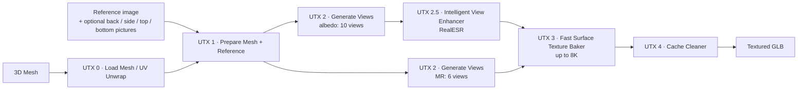

<div align="center">

# UltraTex Modular

### Local 3D texture generation for ComfyUI

**Multi-view FLUX.2 texturing · RealESR-enhanced views · 8K UV baking · Metallic/roughness · Textured GLB**

[](#whats-in-this-version)
[](#license-and-contributing)
[](#installation)
[](#requirements)

**Free source code. No hosted service, subscription, or bundled model weights.**

Created and maintained as a community project by [MostAadTech](https://github.com/Mstafa-awad).

</div>

---

## What is UltraTex Modular?

UltraTex Modular turns a 3D mesh and one reference image into a textured, UV-mapped GLB inside ComfyUI. It uses the
official **UltraTex FLUX.2 Klein base 9B** adapters to paint the model from 10 cameras, sharpens the views with a
RealESR upscaler, and bakes them into a texture atlas of up to **8192 × 8192** together with a metallic/roughness map.



**Everything runs on your computer.** Download the model weights from their original publishers. Your meshes and
references are never uploaded anywhere.

## What's in this version

| Area | What you get |
|---|---|
| **8K textures** | `UTX 2.5 Intelligent View Enhancer` upscales the generated views with a ComfyUI upscale model (tested: Real-ESRGAN `realesr-general-x4v3`) at its native scale, cropped to the model; `UTX 3` bakes them into a 4096 or 8192 atlas. |
| **Bake quality** | `bake_quality = Quality` keeps the source pixels of the best camera (the front view is the anchor) with exact texel support, so thin details (hat bands, buttons, rings, braids) stay sharp. Side and 45° cameras take over where the front sees the surface at a steep angle, but only with colours the other cameras agree on. `Fast` is for previews; `Quality + edge repair` also recolours pixels at geometric edges (removes some silhouette fringes, blurs thin parts, slower). |
| **10 real views** | Six canonical views + four guided 45° views. |
| **Multi-view pictures (optional)** | Give your own back, left side, right side, top or bottom picture. Each picture is fitted onto its own camera only (side pictures facing the wrong way are mirrored automatically), FLUX starts that view from it and the other views follow. Pictures guide the colour only; the metallic/roughness pass ignores them. |
| **Metallic / roughness** | A separate MR pass (UltraTex MR LoRA) is baked into the GLB's metallic-roughness texture (G = roughness, B = metallic). |
| **Reliability** | Every VAE encode is checked twice. This catches a rare corrupted encode from ComfyUI's dynamic-VRAM VAE that used to turn a view grey and stay cached for the whole session. |
| **Speed options** | `fast_decode` decodes each view with one tile layout instead of three (~3× faster decoding, same colours). `refine_denoise` repaints all views from one shared texture for better agreement between views (~+5 min). Both are off by default. |
| **Disk** | Intermediate data lives in a per-session cache that is removed when ComfyUI closes. With `UTX 4 Cache Cleaner` at the end of the graph, a run leaves only the GLB on disk. |
| **Mesh input** | `UTX 0. Load Mesh (v2)`: GLB, glTF, OBJ, PLY, STL, OFF, 3MF; FBX/DAE through an optional Blender. |

Measured on an RTX 5050 Laptop GPU (8 GB) with the included 8K workflow (10 albedo views at 2048, 6 MR views at 1536,
4 steps, RealESR, 8K Quality bake): **about 15–18 minutes per model**, of which the 8K bake takes about 2 minutes.

---

## Requirements

- **ComfyUI** with the V3 custom-node interface and native `MESH` sockets.
- **NVIDIA GPU** with a working CUDA PyTorch, plus Triton for sparse attention.
- **[ComfyUI-GGUF](https://github.com/city96/ComfyUI-GGUF)** installed separately.
- Python **3.11+**.
- Tested: **Windows, PyTorch 2.8.0+cu128, CUDA 12.8, Python 3.12, RTX 5050 Laptop 8 GB**. Larger GPUs work; real 6 GB
  GPUs have not been tested and some 2048 settings may not fit.
- The Python packages in `requirements.txt`.

## Installation

### Option A — git clone

```powershell
cd C:\path\to\ComfyUI\custom_nodes
git clone https://github.com/Mstafa-awad/UltraTex-ComfyUI-nodes
```

### Option B — ZIP

1. Stop ComfyUI.
2. Download the repository ZIP (`Code → Download ZIP`) and extract it into `ComfyUI/custom_nodes/`, so that
   `__init__.py` sits directly inside the extracted folder:

```text
ComfyUI/
└── custom_nodes/
    └── UltraTex-ComfyUI-nodes/
        ├── __init__.py
        ├── simple.py
        ├── fast_baker.py
        ├── core/
        └── ...
```

> Keep only **one** copy of the pack in `custom_nodes` (move older versions outside the folder, don't just rename them).

### Then

1. Install the requirements with **ComfyUI's own Python**:

```powershell
# Example for ComfyUI-Easy-Install / portable builds (Windows)
.\python_embeded\python.exe -m pip install -r .\ComfyUI\custom_nodes\UltraTex-ComfyUI-nodes\requirements.txt
```

2. Install [ComfyUI-GGUF](https://github.com/city96/ComfyUI-GGUF) if it is not present.
3. Download the models below.
4. Restart ComfyUI, refresh the browser and search for **`UTX`**.

---

## Models and LoRA downloads

**No model weights are included.** Download them from the original publishers and save them as shown.

| Item | Source | Save inside `ComfyUI/models/` |
|---|---|---|
| **FLUX.2 Klein base 9B Q4_0 GGUF** | [Unsloth GGUF — 9B Q4_0 file](https://huggingface.co/unsloth/FLUX.2-klein-base-9B-GGUF/blob/main/flux-2-klein-base-9b-Q4_0.gguf) | `diffusion_models/flux-2-klein-base-9b-Q4_0.gguf` |
| **Qwen3-8B Q6_K GGUF** (text encoder) | [Unsloth Qwen3-8B Q6_K file](https://huggingface.co/unsloth/Qwen3-8B-GGUF/blob/main/Qwen3-8B-Q6_K.gguf) | `text_encoders/Qwen3-8B-Q6_K.gguf` |
| **FLUX.2 VAE** | [BFL FLUX.2 Klein base 9B (VAE files)](https://huggingface.co/black-forest-labs/FLUX.2-klein-base-9B/tree/main/vae) | `vae/flux2-vae.safetensors` (a ComfyUI-compatible FLUX.2 VAE checkpoint) |
| **UltraTex albedo LoRA** | [Yibo-Zhang/UltraTex on ModelScope](https://www.modelscope.ai/models/Yibo-Zhang/UltraTex) → `flux2/lora/dit_lora.safetensors` | `loras/ultratex_flux2.safetensors` |
| **UltraTex metallic/roughness LoRA** | [Same repository](https://www.modelscope.ai/models/Yibo-Zhang/UltraTex) → `flux2_mr/lora/dit_lora.safetensors` | `loras/ultratex_flux2_mr.safetensors` |
| **UltraTex foreground-aware decoder** | [Same repository](https://www.modelscope.ai/models/Yibo-Zhang/UltraTex) → `flux2/decoder.pt` | `ultratex/ultratex_flux2_decoder.pt` |
| **Real-ESRGAN general x4v3** (8K workflow) | [Real-ESRGAN release v0.2.5.0](https://github.com/xinntao/Real-ESRGAN/releases/tag/v0.2.5.0) → `realesr-general-x4v3.pth` (BSD-3-Clause) | `upscale_models/realesr-general-x4v3.pth` |

The UltraTex adapters are made for **FLUX.2 Klein base 9B**; they do not work with FLUX.2 4B or FLUX.1. The albedo and
MR LoRAs are different files even though both are called `dit_lora.safetensors` upstream — rename them as shown.
The UltraTex weights can also be fetched with the publisher's CLI:

```bash
pip install modelscope
modelscope download --model Yibo-Zhang/UltraTex --local_dir UltraTex_weights
```

Copy only the `flux2` and `flux2_mr` files listed above.

```text
ComfyUI/models/
├── diffusion_models/flux-2-klein-base-9b-Q4_0.gguf
├── text_encoders/Qwen3-8B-Q6_K.gguf
├── vae/flux2-vae.safetensors
├── loras/ultratex_flux2.safetensors
├── loras/ultratex_flux2_mr.safetensors
├── ultratex/ultratex_flux2_decoder.pt
└── upscale_models/realesr-general-x4v3.pth
```

---

## Workflows

Drag a file from [`workflows/`](workflows) into ComfyUI:

- **`MostAadTech_UltraTex_8k.json`** — the full 8K workflow: 10 albedo views at 2048, MR at 1536, RealESR enhancer,
  8192 atlas, cache cleaner.
- **`MostAadTech_UltraTex_workflow.json`** — the earlier 4K workflow: 12 albedo and 12 MR views at 2048, no enhancer,
  4096 atlas.

Workflows saved with older versions load as they are: removed baker options are converted automatically
(`sharp_anchor_v2`, `sharp_anchor`, `sharp_source` → `Quality`; `fast_detail`, `off_direct` → `Fast`), and new
inputs start at their defaults.

### First run

1. **UTX 0. Load Mesh (v2)** — pick a mesh from `ComfyUI/input` or enter a path. If it has no usable UVs, add
   **UTX 0. UV Unwrap Mesh** (`comfy_gpu`, or `xatlas`).
2. **UTX 1. Prepare Mesh + Reference** — connect the reference image (and its mask, if you have one).
3. **UTX 2. Generate Views + LoRA** — once with the albedo LoRA (`task = albedo`, 10 views) and once with the MR LoRA
   (`task = mr`, 6 views).
4. **UTX 2.5 — Intelligent View Enhancer** (8K) — `enabled`, `upscaler = Comfy upscale model`,
   `target = Native model scale`, connect a `Load Upscale Model` node with `realesr-general-x4v3.pth`.
5. **UTX 3. Fast Surface Texture Baker** — `texture_size` 4096 or 8192, `bake_quality = Quality`.
6. **UTX 4. Cache Cleaner** → **Save GLB**.

## Settings guide

### UTX 1 · multi-view pictures

`UTX 1. Prepare Mesh + Reference` has optional inputs `reference_back`, `reference_character_left_side`,
`reference_character_right_side`, `reference_top` and `reference_bottom`, each with an optional mask.
Use them when you need a specific pattern somewhere the front reference cannot show (an emblem on the back, a
tattoo on one arm). You can connect any of them, one or several.

- "Left side" means **the character's own left**. A side picture that faces the wrong way is mirrored automatically;
  top and bottom pictures are also turned. Each picture can only land on its own camera, so a back picture can never
  end up on the front.
- `view_reference_strength` (default 0.5) is how long FLUX is held to the picture: 0.5 = the first half of the steps.
  Higher keeps the picture more literally, lower lets FLUX adapt it more to the mesh.
- The `view_references_512` output shows where each picture landed; the console prints one line per picture.
- Pictures guide the albedo (colour) pass only. The metallic/roughness pass is generated exactly as without pictures.

### UTX 2 · Generate Views + LoRA

| Input | Recommendation |
|---|---|
| `view_resolution` | 2048 for the best texture on 8 GB; 1024 for a light test. |
| `view_count` | 10 (6 canonical + 4 guided 45°). |
| `steps` | The included workflows use 4. More steps take proportionally longer. |
| `extra_denoise` | Keep 1.0: the guided 45° pass already pins everything the first six views saw well. |
| `refine_denoise` | 0.35 (with `refine_steps` 4) repaints every view from one shared texture: better agreement between views, fewer colour fringes, about 5 minutes more. 0 = off. |
| `fast_decode` | On = one tiled-decode layout instead of three, about 3× faster decoding with the same colours. |

### UTX 3 · Fast Surface Texture Baker

| `bake_quality` | Use |
|---|---|
| `Quality` | Default. Sharpest result: the front camera's pixels are kept where it sees the surface well; other cameras take over at steep angles. |
| `Fast` | Quick previews. |
| `Quality + edge repair` | Also rejects and recolours pixels next to geometric edges. Removes some silhouette colour fringes but blurs thin parts and is slower. |

The final texture resolution is set here (`texture_size`), not in UTX 2.5. An 8192 atlas needs more RAM and about two
minutes of bake time on an 8 GB laptop GPU.

---

## UTX 4 — Cache Cleaner

UltraTex keeps intermediate data (views, G-buffers, latents) in `ComfyUI/output/.ultratex_cache/session_…`. That folder
belongs to one ComfyUI session and is deleted when ComfyUI closes; if ComfyUI crashed, it is deleted at the next start.

`UTX 4. Cache Cleaner` handles the rest. By default it only reports sizes (**Scan Size** button). **Delete Now** asks
for confirmation first. It only touches direct children of `ComfyUI/output` that are UltraTex temporary folders:

```text
ComfyUI/output/
├── .ultratex_cache/             ← temporary: can delete
├── ultratex_views_<ID>/         ← temporary: can delete
├── ultratex/                    ← PROTECTED: saved GLBs, textures
└── anything_else/               ← PROTECTED
```

**To keep nothing but the GLB after every run:** place the cleaner after the baker (before Save GLB), set
`mode = delete_when_executed` and `confirm_delete_on_run = true`. The next run then cannot reuse cached work and
regenerates everything. Skip `UTX Save View Bundle` if you don't need view bundles (each is about 2 GB).

**Warning:** never delete these folders while an UltraTex job is running. Deletion is permanent (no Recycle Bin).
Junctions/symlinks and unreadable folders are refused.

---

## Optional: full-context VAE test mode

Normal startup uses the tiled VAE, which is the quality reference. `tools/Start-UltraTex.ps1 -Mode FullContextTest`
starts ComfyUI with an experimental full-context decoder that is faster but can change colours and fine details.
It is off unless you start ComfyUI this way; see [FULL_CONTEXT_TEST.md](FULL_CONTEXT_TEST.md). Restart in `Legacy` mode to go back.

---

## License and contributing

**UltraTex Modular project-authored source is distributed under the GNU GPL version 3.0.** See [LICENSE](LICENSE).
Vendored MIT/Apache-2.0 code keeps its original notices; see [THIRD_PARTY_NOTICES.md](THIRD_PARTY_NOTICES.md),
[vendor/UPSTREAM_LICENSE](vendor/UPSTREAM_LICENSE) and the [SLA Apache-2.0 license](vendor/sparse_attention/LICENSE.txt).

- **Free to use, inspect, modify and redistribute** under the GPL terms.
- If you **distribute a modified version**, GPLv3 requires you to provide the corresponding source; please send
  improvements back as pull requests. Private edits do not have to be published.
- No model weights are distributed by this project, and this license does not replace the model or LoRA license terms.

### Commercial use of generated outputs

Generated textures and assets can be used commercially when the upstream model and adapter licenses permit it. The
BFL FLUX.2 Klein base 9B license allows commercial use of outputs **subject to its restrictions**; the FLUX base 9B
model itself is under a non-commercial license, so commercial *use of the model* may need a separate BFL license. The
UltraTex LoRA/decoder publisher may have further terms. This project adds no watermark, royalty, or ownership claim to
your generated files. Read the [BFL FLUX.2 Klein base 9B license](https://huggingface.co/black-forest-labs/FLUX.2-klein-base-9B/blob/main/LICENSE.md)
and the [UltraTex publisher repository](https://github.com/yiboz2001/UltraTex) before commercial use. This is not legal advice.

### Contributions

Bug fixes, speed-ups, hardware reports, bake-quality tests and mesh importers are welcome. Keep the original notices,
document new third-party dependencies and their licenses, and don't commit model weights.

---

## Troubleshooting

| Problem | What to check |
|---|---|
| Nodes don't show | One copy of the pack in `custom_nodes`, `__init__.py` directly inside its folder, requirements installed with ComfyUI's Python, ComfyUI restarted. |
| Missing GGUF node | Install and enable [ComfyUI-GGUF](https://github.com/city96/ComfyUI-GGUF). |
| LoRA validation fails | Albedo and MR LoRA swapped, or not **FLUX.2 Klein base 9B**. |
| Missing foreground decoder | Put `ultratex_flux2_decoder.pt` in `ComfyUI/models/ultratex/`. |
| No or invalid UVs | Turn off `copy_uvs` in UTX 0 Load Mesh and add UTX 0 UV Unwrap Mesh. |
| Can't import FBX | Set `blender_path` to a working Blender, or export the mesh as GLB/OBJ. |
| Console says "VAE encode returned two different latents … corrupted encode discarded" | Expected now and then with dynamic VRAM: the bad encode was caught and replaced. |
| A material looks like metal | The MR LoRA decides the materials from the reference. Some characters (e.g. dark armoured outfits) come out as rough metal everywhere. Check the MR preview before baking. |
| Out of memory on 6 GB | Lower `view_resolution` or the atlas size; 6 GB GPUs are not tested. |
| Texture blurry at 8K | 8K needs the enhancer (UTX 2.5) with an upscale model; an atlas cannot add detail the views don't have. Look at the generated views first. |

---

<div align="center">

**Built with care for free, local creative tools.**
[UltraTex research](https://github.com/yiboz2001/UltraTex) · [ComfyUI](https://github.com/comfyanonymous/ComfyUI) · [ComfyUI-GGUF](https://github.com/city96/ComfyUI-GGUF) · [Real-ESRGAN](https://github.com/xinntao/Real-ESRGAN)

</div>
