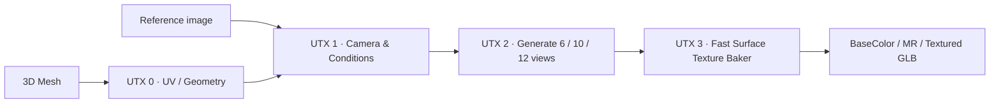

<div align="center">

# UltraTex Modular · v2

### Local 3D texture generation for ComfyUI

**High-detail multi-view texturing · Native MESH workflow · GPU-aware execution · Fast UV baking**

[](#whats-new-in-v2)
[](#license-and-contributing)
[](#installation)
[](#requirements)

**Free source code. No hosted service, subscription, or bundled model weights.**

Created and maintained as a community project by [MostAadTech](https://github.com/Mstafa-awad).

</div>

---

## What is UltraTex Modular?

UltraTex Modular is a node-based system for converting a 3D mesh and reference image into detailed multi-view texture evidence and a baked, UV-mapped asset. It integrates the official **UltraTex FLUX.2 Klein base 9B** adapters with a ComfyUI-native mesh pipeline. Materials can be assembled into a usable textured GLB without leaving ComfyUI.



**Everything runs on your computer.** Download model weights separately from their original publishers. The standard pipeline does not upload your meshes or references to a hosted UltraTex service.

## What's new in v2

| Area | What v2 provides |
|---|---|
| **Speed & memory** | Streamed GGUF MLP, tiled LoRA handling, Q/K temporary-buffer improvements, adaptive GPU-budget planning, and optional faster full-context VAE research mode |
| **Multi-view generation** | Six canonical views + four guided diagonal views (**10 real views**, not 12 with two hidden); legacy 6/12-view choices remain |
| **Texture reconstruction** | Coverage-aware baking, visibility/depth checks, hole completion/inpainting-oriented surface fill, and detailed fast bake |
| **Low-resolution workflows** | 1024 view generation remains supported with the improved multi-view fusion and baking controls; use UV resolution independently from generation resolution |
| **Modular outputs** | Separate BaseColor, metallic/roughness-related outputs, MESH inputs, and a native textured GLB export path |
| **New in this package** | **UTX 0. Load Mesh (v2)** — GLB, glTF, OBJ, PLY, STL, OFF, 3MF; FBX/DAE through optional Blender; a `copy_uvs` checkbox |
| **Project cleanup** | One installable node pack, without old workflow JSONs, generated caches, obsolete setup notes, or benchmark debris |

### Tested performance — what the numbers really mean

These measurements compare the **experimental full-context VAE mode** with the **normal tiled decoder**, using the same FLUX model and view-resolution settings. They are not universal performance guarantees.

| Experiment | Normal tiled | Full-context experimental | Result |
|---|---:|---:|---|
| Character · first matched run | 609.98 s | 511.36 s | **16.2% shorter runtime** |
| Deer · combined candidate | 488.34 s | 366.48 s | **25.0% shorter runtime**; GPU dedicated peak **+64 MiB** |
| Deer · final native-storage isolation | 488.34 s | 375.18 s | **23.2% shorter runtime** in one diagnostic run |
| One 2048 VAE view | ~13.7 s | ~3.8 s | **~3.6× faster decoding** in an isolated benchmark |

The experimental decoder is **OFF by default**. It changes full-image normalization/attention context, so colors and fine image details **can differ** from the tiled path. Repeatability and quality across models/scenes are **not certified**. Do not present these figures as certified v2 default-mode speedups or as proof of visually identical output.

### Quality and inpainting

The baker combines views using geometric visibility information and coverage-aware reconstruction. It is designed to reduce missed texels, seams, and weak projection areas; it provides `fast_detail` and `off_direct` strategies and configurable surface filling. **Inpainting and low-resolution output quality depend on visibility, the generated views, UV layout, mesh topology and settings.** Improvements are architectural capabilities, not a promise that every 1024 asset will beat every older release. Inspect 1:1 texture details and the final model.

---

## Requirements

- **ComfyUI** with support for the V3 custom-node interface and native `MESH` sockets.
- **NVIDIA GPU** with compatible CUDA/PyTorch and the GGUF + Triton/SLA dependencies.
- **[ComfyUI-GGUF](https://github.com/city96/ComfyUI-GGUF)** installed separately.
- Python **3.11+** (the Windows development system used Python 3.12.10).
- Recommended tested environment: **PyTorch 2.8.0+cu128, CUDA 12.8, ComfyUI 0.39.2**, Windows, RTX 5050 Laptop 8GB. No CUDA 13 upgrade is required by this project's tested path.
- The Python packages from `requirements.txt`, including `trimesh` for the new mesh loader.

**GPU-size expectations:** RTX 5050 8GB has direct test evidence. A restricted budget on an 8GB card ran one complete workload below ~5.8GiB sampled dedicated memory, but **real 6GB GPUs have not been tested** and some 2048 tasks may be refused when memory is insufficient. 16GB+ uses adaptive native residency when available; speed gains on real 16GB hardware have not been measured. A GPU's advertised capacity alone does not guarantee that a workflow will fit.

## Installation

### Option A — ZIP (easiest)

1. Download this repository's **release ZIP**.
2. Stop ComfyUI.
3. Extract it so the directory structure is exactly:

```text
ComfyUI/
└── custom_nodes/
    └── comfyui_ultratex_modular/
        ├── __init__.py
        ├── extension.py
        ├── mesh_loader_v2.py
        ├── README.md
        ├── LICENSE
        └── ...
```

> **Important:** Put the **extracted folder**, not the `.zip` archive itself, in `custom_nodes`. Avoid nesting `comfyui_ultratex_modular/comfyui_ultratex_modular` and don't keep two active copies. Back up the previous version **outside** `custom_nodes` first.

4. Install dependencies using **ComfyUI's Python**, not an unrelated system installation:

```powershell
# Example from the ComfyUI-Easy-Install root (Windows)
.\python_embeded\python.exe -m pip install -r .\ComfyUI\custom_nodes\comfyui_ultratex_modular\requirements.txt
```

5. Install [ComfyUI-GGUF](https://github.com/city96/ComfyUI-GGUF) if it is not present; follow its own setup instructions. Keep the working PyTorch/CUDA/Triton combination unless you intentionally validate another.
6. Download the models listed [below](#models-and-lora-downloads).
7. Restart ComfyUI and search for **`UTX`** nodes.

### Option B — GitHub clone

Clone **the published UltraTex v2 repository URL** directly into `ComfyUI/custom_nodes`. Once the repository is published, replace `<YOUR-ULTRATEX-V2-REPOSITORY-URL>` with its real URL:

```powershell
cd C:\path\to\ComfyUI\custom_nodes
git clone <YOUR-ULTRATEX-V2-REPOSITORY-URL> comfyui_ultratex_modular
```

Then install requirements and weights as described above. **The GitHub v2 URL has not been supplied yet; the placeholder is intentional.** The official [UltraTex research repository](https://github.com/yiboz2001/UltraTex) is a different upstream project, not this custom-node ZIP.

---

## Models and LoRA downloads

**The ZIP contains no trained models.** Keep their original file formats and copy/rename to the locations shown. All links are official upstream pages or a specifically identified GGUF publisher, not rehosted weight files.

| Item | Source | Save inside `ComfyUI/models/` |
|---|---|---|
| **FLUX.2 Klein base 9B Q4_0 GGUF** | [Unsloth GGUF — exact 9B Q4_0 file](https://huggingface.co/unsloth/FLUX.2-klein-base-9B-GGUF/blob/main/flux-2-klein-base-9b-Q4_0.gguf) | `diffusion_models/flux-2-klein-base-9b-Q4_0.gguf` |
| **Qwen3-8B Q6_K GGUF** | [Unsloth Qwen3-8B Q6_K file](https://huggingface.co/unsloth/Qwen3-8B-GGUF/blob/main/Qwen3-8B-Q6_K.gguf) | `text_encoders/Qwen3-8B-Q6_K.gguf` |
| **FLUX.2 VAE** | [BFL FLUX.2 Klein base 9B (VAE files)](https://huggingface.co/black-forest-labs/FLUX.2-klein-base-9B/tree/main/vae) | `vae/flux2-vae.safetensors` — use the compatible VAE checkpoint (rename or convert only when compatible with ComfyUI's loader) |
| **UltraTex albedo LoRA** | [Yibo-Zhang/UltraTex ModelScope](https://www.modelscope.ai/models/Yibo-Zhang/UltraTex) → `flux2/lora/dit_lora.safetensors` | `loras/ultratex_flux2.safetensors` |
| **UltraTex metallic/roughness LoRA** | [Same ModelScope repository](https://www.modelscope.ai/models/Yibo-Zhang/UltraTex) → `flux2_mr/lora/dit_lora.safetensors` | `loras/ultratex_flux2_mr.safetensors` |
| **UltraTex foreground-aware decoder** | [Same ModelScope repository](https://www.modelscope.ai/models/Yibo-Zhang/UltraTex) → `flux2/decoder.pt` | `ultratex/ultratex_flux2_decoder.pt` |

The FLUX 9B adapters **are not interchangeable with FLUX 4B**. Use **FLUX.2 Klein base 9B**, not distilled 4B and not an unrelated FLUX.1 checkpoint. The UltraTex albedo and MR adapters are different files even if their original downloaded names are both `dit_lora.safetensors`.

Suggested layout:

```text
ComfyUI/models/
├── diffusion_models/
│   └── flux-2-klein-base-9b-Q4_0.gguf
├── text_encoders/
│   └── Qwen3-8B-Q6_K.gguf
├── vae/
│   └── flux2-vae.safetensors
├── loras/
│   ├── ultratex_flux2.safetensors
│   └── ultratex_flux2_mr.safetensors
└── ultratex/
    └── ultratex_flux2_decoder.pt
```

**Downloading both UltraTex LoRAs and decoder:** From the [official UltraTex repository](https://github.com/yiboz2001/UltraTex), download the FLUX.2-specific weights at the ModelScope link above. Its suggested CLI command is:

```bash
pip install modelscope
modelscope download --model Yibo-Zhang/UltraTex --local_dir UltraTex_weights
```

Copy only the `flux2` and `flux2_mr` artifacts listed above; you do not need to install the research repo or copy its entire `checkpoints` directory into ComfyUI. If a provider changes its filenames or repository layout, follow the publisher's current instructions and verify adapter task identity. The VAE in some repositories is published in Diffusers subfolders rather than a directly loadable single file; **do not assume any VAE `diffusion_pytorch_model.safetensors` can just be renamed**—use a compatible FLUX.2 ComfyUI VAE checkpoint. If you already have a working `flux2-vae.safetensors`, keep it.

---

## First run · recommended node setup

1. **UTX 0. Load Mesh (v2)**: pick a mesh from the dropdown (put it in `ComfyUI/input`) or enter an absolute path. `copy_uvs` preserves valid existing UVs; uncheck it to unwrap later.
2. If your mesh has no usable UVs, connect **UTX 0. UV Unwrap Mesh** (`comfy_gpu` or optional `xatlas`).
3. Use **UTX 1** to prepare the original mesh, camera views, normals and reference-image conditions.
4. Load **FLUX.2 Klein base 9B GGUF** and its **Qwen3-8B** text encoder, VAE and UltraTex foreground decoder; apply the correct albedo/MR LoRA.
5. Generate with **UTX 2**. For full multi-view coverage, use **10 views (6 canonical + 4 guided)**, `2048` view resolution on sufficient VRAM, or `1024` for a lighter workflow. Settings such as guidance and steps remain yours to choose.
6. Feed the generated views and source MESH to **UTX 3 Fast Surface Texture Baker**; set the atlas resolution independently (e.g. 2048 or 4096) and select `fast_detail` or `off_direct` as appropriate.
7. Connect the resulting BaseColor/MR maps to the material stage and export your textured GLB.

**Note:** v2 intentionally ships **without bundled workflow JSON files**, so you can publish the official workflow separately.

### New mesh-loader notes

- Dropdown: `.glb`, `.gltf`, `.obj`, `.ply`, `.stl`, `.off`, `.3mf` under `ComfyUI/input` (including subfolders).
- Custom path: absolute path or a relative path inside `ComfyUI/input`.
- **FBX/DAE:** enter a file path and set `blender_path` to `blender.exe` if Blender is not on PATH. It imports to a temporary GLB using Blender, then constructs the native MESH. The original source file is not modified. Support depends on your Blender import/export capability.
- **Copy UVs = ON**: existing valid vertex UVs are copied (and OBJ V coordinates are converted to native glTF/ComfyUI V-down). Missing/invalid UVs raise a helpful error instead of silently inventing coordinates.
- **Copy UVs = OFF**: only geometry/normals are loaded; unwrap with UTX separately.
- Mesh instances are combined into a single native MESH with node transforms applied; per-face material slots, textures, skinning, animation and morph targets are **not** imported by this geometry-only node. UV islands can overlap across objects/materials; inspect/unwrap before baking.

---

## Faster decoding: opt-in research mode

**Normal startup uses the established tiled VAE** and is the recommended quality-reference path. The experimental **FullContextTest** can substantially reduce 2048 decode time, but changes the normalization and attention context and may alter output color/details. It is **not** equivalent to the old decoder and is currently a TEST feature.

Use the supplied optional PowerShell helper from the plugin folder (adjust paths to your installation):

```powershell
.\tools\Start-UltraTex.ps1 -Mode FullContextTest -ComfyRoot 'C:/path/ComfyUI' -PythonPath 'C:/path/python_embeded/python.exe'
```

First use `-DryRun` to inspect the command. The tested 8GB full-context configuration requires an explicit startup allocator cap and restarts to switch modes. **Never assume the default cap fits another GPU.** See [FULL_CONTEXT_TEST.md](FULL_CONTEXT_TEST.md) for exact environment switches, safeguards and rollback. To restore the standard tiled behavior, restart in `Legacy` mode.

---

## License and contributing

**UltraTex Modular v2 project-authored source is distributed under GNU GPL version 3.0.** See [LICENSE](LICENSE). Vendored MIT/Apache-2.0 code keeps all original notices; see [THIRD_PARTY_NOTICES.md](THIRD_PARTY_NOTICES.md), [vendor/UPSTREAM_LICENSE](vendor/UPSTREAM_LICENSE) and [SLA Apache-2.0 license](vendor/sparse_attention/LICENSE.txt).

- **Free to use, inspect, modify and redistribute** under the GPL terms.
- When you **distribute a modified version**, GPLv3 requires you to provide corresponding source and honor GPL rights; please contribute improvements back through pull requests. **Private edits do not automatically have to be published.**
- **GPL permits charging for copies and commercial distribution.** If you want to prohibit resale, that cannot be achieved using standard GNU GPLv3. Please do not claim GPL forbids selling software.
- No model weights are distributed by the project, and this license **does not supersede the model or LoRA license terms**.

### Commercial use of generated outputs

**Generated textures/assets can be used commercially when the applicable upstream model and adapter licenses permit it.** The referenced BFL FLUX.2 Klein base 9B license says that outputs may be used commercially **subject to its restrictions** (including restrictions on competitive-model training and required content review/filtering or disclosure where applicable). **The FLUX base 9B model itself is non-commercially licensed**; commercial/production *model use* may require a separate BFL license. The UltraTex LoRA/decoder publisher may have additional terms; check them before commercial distribution. This project adds no watermark, royalty, or claim of ownership over your generated files.

Read the [BFL FLUX.2 Klein base 9B license](https://huggingface.co/black-forest-labs/FLUX.2-klein-base-9B/blob/main/LICENSE.md) and the [UltraTex publisher repository](https://github.com/yiboz2001/UltraTex) before commercial deployment. **No unconditional legal guarantee of commercial safety is made.**

### Contributions

Bug fixes, performance improvements, new hardware validation, bake-quality tests and mesh importers are welcome. Keep original notices, include corresponding source when redistributing GPL-covered changes, and document any third-party dependencies and their licenses. Please don't package other people's model weights into source-code releases.

---

## Troubleshooting

| Problem | What to check |
|---|---|
| Nodes don't show | Folder nesting; one copy of the plugin; restart ComfyUI; install requirements using embedded Python |
| Missing GGUF node | Install and enable [ComfyUI-GGUF](https://github.com/city96/ComfyUI-GGUF) |
| LoRA validation fails | Check that albedo and MR files weren't swapped and that you're using **Klein base 9B** |
| Missing foreground decoder | Put `ultratex_flux2_decoder.pt` in `ComfyUI/models/ultratex/` |
| No UVs or invalid UVs | Uncheck `copy_uvs` and run UTX UV Unwrap Mesh; validate UV collisions/islands |
| Can't import FBX | Set `blender_path` to a working Blender executable, or export the mesh as GLB/OBJ |
| OOM on 6GB | Try reduced workload where acceptable, or supported low-memory controls. Native 6GB support is not certified; do not expect full 2048 + LoRA to always fit |
| Experimental output changes color | FullContextTest changes VAE context. Restart in `Legacy` mode for original tiled decoding |
| Texture appears blurry at 4K | A 4096 atlas cannot create detail absent from 1024/2048 source views; inspect zoom, UV texel density and surface coverage |

---

<div align="center">

**Built with care for free, local creative tools.**  
[UltraTex research](https://github.com/yiboz2001/UltraTex) · [ComfyUI](https://github.com/comfyanonymous/ComfyUI) · [ComfyUI-GGUF](https://github.com/city96/ComfyUI-GGUF)

</div>
